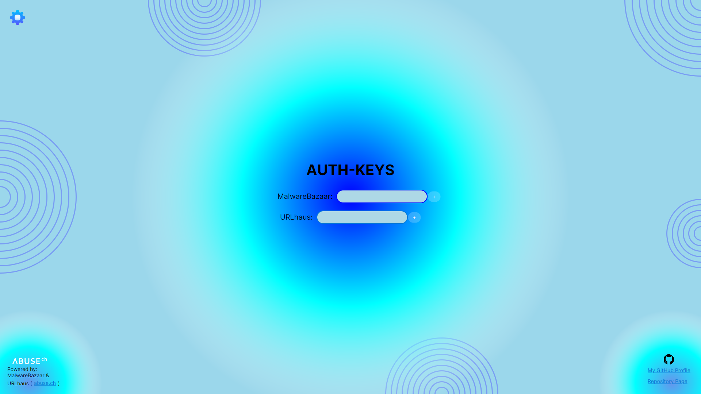
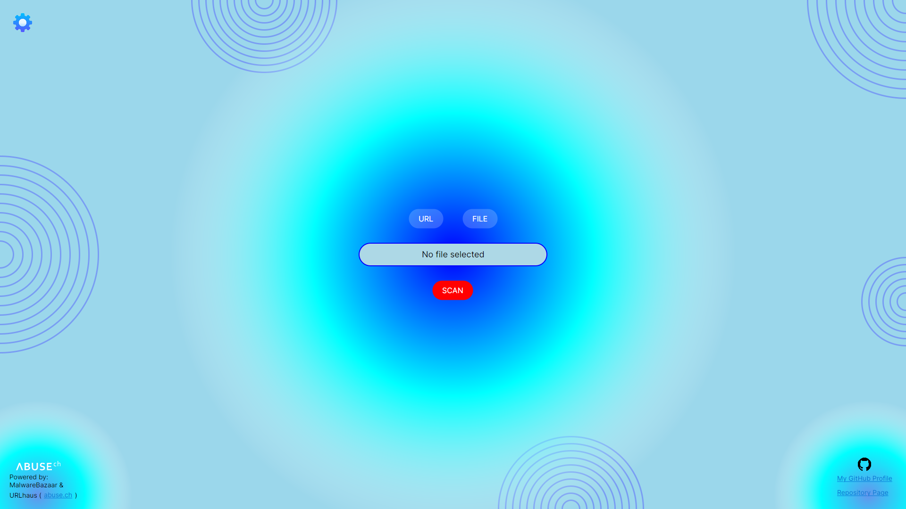
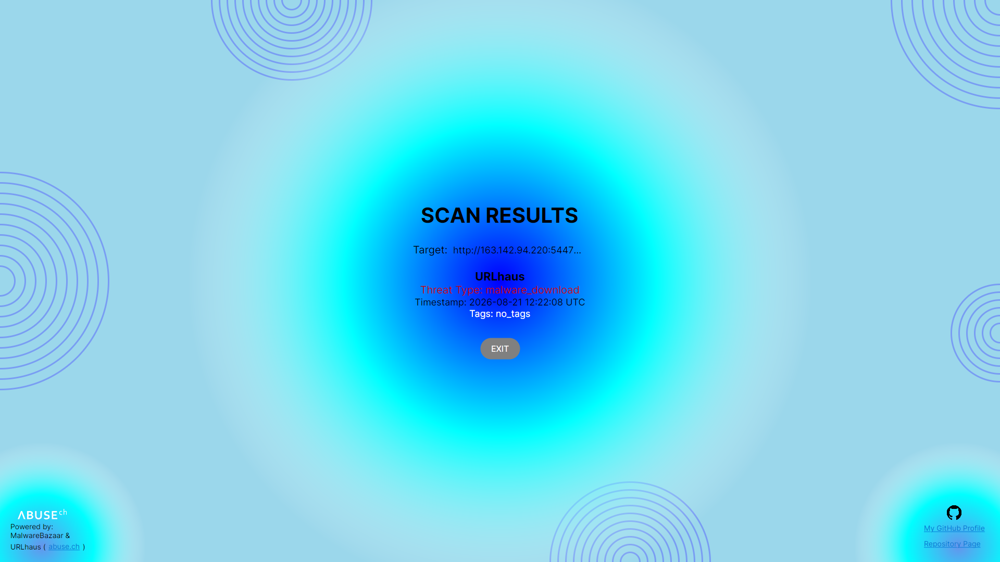
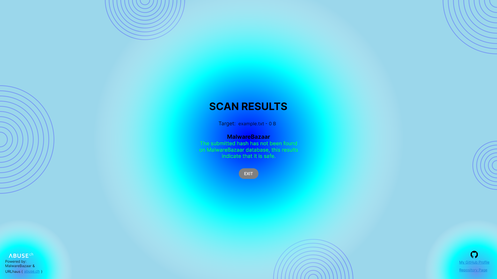
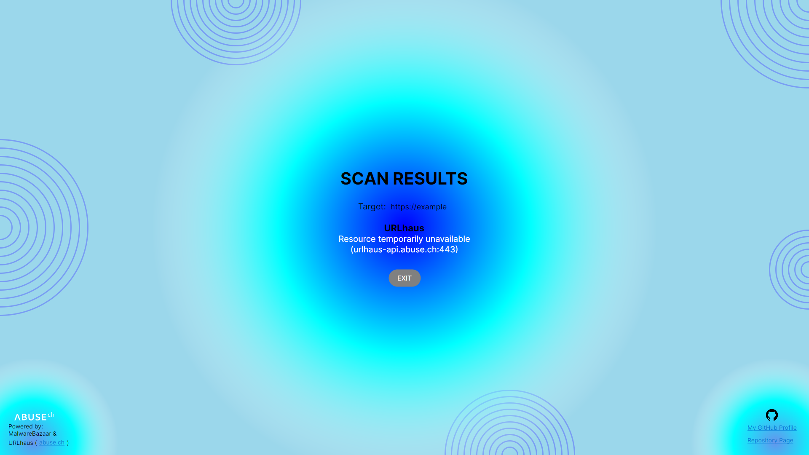

<a id="readme-top"></a>

<br />
<div align="center">
  
 <h1 style="border-bottom: none; margin-bottom: 0;">ThreatFinder v1.0.0</h1>

  <p align="center">
    An awesome URL and file scanner!
    <br />
    <a href="https://github.com/PsHyCo71/ThreatFinder"><strong>Go To Project »</strong></a>
    <br />
    <a href="https://github.com/PsHyCo71/ThreatFinder/issues/new?labels=bug&template=bug-report---.md">Report Bug</a>
    &middot;
    <a href="https://github.com/PsHyCo71/ThreatFinder/issues/new?labels=enhancement&template=feature-request---.md">Request Feature</a>
  </p>
</div>

<div align="center">

[![Contributors][contributors-shield]][contributors-url]
[![Forks][forks-shield]][forks-url]
[![Stargazers][stars-shield]][stars-url]
[![Issues][issues-shield]][issues-url]
[![License][license-shield]][license-url]

</div>

## Table of Contents

- [Table of Contents](#table-of-contents)
- [Description](#description)
  - [Built With](#built-with)
- [Features](#features)
- [Getting Started](#getting-started)
  - [Prerequisites](#prerequisites)
    - [.NET SDK Installation Guide (Windows)](#net-sdk-installation-guide-windows)
    - [.NET SDK Installation Guide (Linux)](#net-sdk-installation-guide-linux)
  - [Installation](#installation)
- [How To Use](#how-to-use)
- [Examples](#examples)
- [Contributing](#contributing)
- [Credits](#credits)
- [Security Note](#security-note)
- [Terms of Use \& Fair Use Principles](#terms-of-use--fair-use-principles)
- [License](#license)

## Description

ThreatFinder is a cross-platform (Windows/Linux) desktop app built with C# and Avalonia UI that checks whether a file hash or URL is known to be malicious, using MalwareBazaar for file hash lookups and URLhaus for URL lookups.

The app follows the MVVM pattern, using CommunityToolkit.Mvvm for observable properties and commands, with a clean separation between the core scanning logic (`ThreatFinder.Core`, `ThreatFinder.Providers`) and the Avalonia UI (`ThreatFinder.UI`). The provider architecture (`IThreatIntelProvider`) is designed to support additional threat intelligence sources in the future.

### Built With

* [![C#][csharp-shield]][csharp-url]
* [![Avalonia][avalonia-shield]][avalonia-url]
* [![abuse.ch][abusech-shield]][abusech-url]
* [![linux][linux-shield]][linux-url]
* [![Windows][windows-shield]][windows-url]

<p align="right">(<a href="#readme-top">back to top</a>)</p>

## Features

* 🔍 **Hash & URL scanning** — check a file's SHA-256 hash against MalwareBazaar or a URL against URLhaus
* 🗂️ **File hashing built-in** — pick a file and ThreatFinder computes its SHA-256 hash locally, no manual hashing needed
* 🚦 **Clear result states** — every scan resolves into one of three outcomes: **Malicious**, **Clean**, or **Error**, each with a dedicated view
* 🔑 **Bring your own API key** — securely store your personal MalwareBazaar and URLhaus Auth-Keys in Settings
* 🧩 **Extensible provider architecture** — threat intelligence sources are abstracted behind `IThreatIntelProvider`, making it straightforward to add more providers in the future
* 🖥️ **Cross-platform** — runs on both Windows and Linux via Avalonia UI

<p align="right">(<a href="#readme-top">back to top</a>)</p>

## Getting Started

### Prerequisites

* Windows 10/11 (x64) or Linux (x64)
* .NET SDK 10.0 (or later)

#### .NET SDK Installation Guide (Windows)

- From the website
    - Open your browser and go to this [page](https://dotnet.microsoft.com/en-us/download/dotnet)
    - Install latest version
    - Execute the downloaded file
    - Check if dotnet is installed by typing this in the Command Prompt or Powershell
        ```bash
        dotnet --version
        ```
- With package manager
    - Open the Command Prompt or Powershell as administrator
    
    - Choose one of the following package managers for Windows:
        ```bash
        winget install Microsoft.DotNet.SDK.10
        ```
        ```bash
        scoop install dotnet-sdk      # Only on powershell
        ```
        ```bash
        choco install dotnet-sdk -y   # Only on powershell
        ```
    - and check:
        ```bash
        dotnet --version
        ```

#### .NET SDK Installation Guide (Linux)

- With **pacman**
    - Open a terminal emulator (e.g. Alacritty, Kitty, GNOME Terminal, or Konsole)
        ```bash
        sudo pacman -Syu # Make sure that the system is synchronized and updated
        sudo pacman -S dotnet-sdk
        ```
    - and check:
        ```bash
        dotnet --version
        ```

### Installation

1. **Download** the `.exe` from the [Releases](https://github.com/PsHyCo71/ThreatFinder/releases) page
2. Otherwise **clone** the repo
    ```bash
    git clone https://github.com/PsHyCo71/ThreatFinder.git
    ```
3. Navigate to the project directory
   ```bash
   cd ThreatFinder
   ```
4. **Run** the project
    ```bash
    dotnet run
    ```

<p align="right">(<a href="#readme-top">back to top</a>)</p>

## How To Use

1. **Get** a free API key at [abuse.ch](https://auth.abuse.ch)
2. Once the program is running open the settings (blue gear on the top left)



3. On the main page select **URL** or **FILE** based on your needs



4. Enter your **URL** or pick your **file** of choice
5. Click **SCAN** or press `Enter`
6. **Finally look at the result!**

<p align="right">(<a href="#readme-top">back to top</a>)</p>

## Examples

While operating the program 3 type of result may appear:

1. The **URL** or **file** is recognised as **malicious**



2. The **URL** or **file** is recognised as **safe/clean**



3. An **error** occured while the program was scanning



<p align="right">(<a href="#readme-top">back to top</a>)</p>

## Contributing

If you have a suggestion that would make this better, please fork the repo and create a pull request. You can also simply open an issue with the tag "enhancement".
Don't forget to give the project a star! Thanks again!
For more info read the [`CONTRIBUTING.md`][contributing-url] file.

1. Fork the Project
2. Create your Feature Branch
   ```bash
   git checkout -b feature/AmazingFeature
   ```
3. Commit your Changes
   ```bash
   git commit -m "Add some AmazingFeature"
   ```
4. Push to the Branch
   ```bash
   git push origin feature/AmazingFeature
   ```
5. Open a Pull Request

<p align="right">(<a href="#readme-top">back to top</a>)</p>

## Credits

ThreatFinder is powered by [MalwareBazaar](https://bazaar.abuse.ch/) and [URLhaus](https://urlhaus.abuse.ch/), two threat intelligence databases operated by the **abuse.ch** community (in partnership with Spamhaus).

- **MalwareBazaar** collects and shares confirmed malware samples with the infosec community.
- **URLhaus** collects and shares malicious URLs used for malware distribution.

<p align="right">(<a href="#readme-top">back to top</a>)</p>

## Security Note

Your MalwareBazaar and URLhaus Auth-Keys are stored locally in `appsettings.json` (excluded from version control via `.gitignore`). Never commit or share this file — anyone with access to it can use your API keys.

## Terms of Use & Fair Use Principles

ThreatFinder relies on the **Community API** of both MalwareBazaar and URLhaus, which is provided free of charge under abuse.ch's fair use principles.

- These APIs are intended for personal, research, and non-commercial threat intelligence use.
- Access is subject to abuse.ch's Query Volume Limits; exceeding them may result in temporary or permanent restrictions.
- Commercial or for-profit use by companies or networks may require a paid subscription to abuse.ch's commercial API, managed by Spamhaus.
- Users of ThreatFinder must obtain their own personal Auth-Key from abuse.ch to use the application, and are responsible for complying with abuse.ch's Terms of Use and submission policies.
- ThreatFinder does not redistribute, cache, or resell any data obtained from these APIs; all queries are made live and directly by the user's own Auth-Key.

For full details, refer to the official documentation:
- [abuse.ch's Terms of Use](https://abuse.ch/terms-of-use/)
- [MalwareBazaar API documentation](https://bazaar.abuse.ch/api/)
- [URLhaus API documentation](https://urlhaus.abuse.ch/api/)

<p align="right">(<a href="#readme-top">back to top</a>)</p>

## License

Distributed under the PolyForm NonCommercial License 1.0.0.
See [`LICENSE.md`](https://github.com/PsHyCo71/ThreatFinder/blob/main/LICENSE.md) for more info.

<p align="right">(<a href="#readme-top">back to top</a>)</p>

[contributors-shield]: https://img.shields.io/github/contributors/PsHyCo71/ThreatFinder.svg?style=for-the-badge
[contributors-url]: https://github.com/PsHyCo71/ThreatFinder/graphs/contributors

[forks-shield]: https://img.shields.io/github/forks/PsHyCo71/ThreatFinder.svg?style=for-the-badge
[forks-url]: https://github.com/PsHyCo71/ThreatFinder/network/members

[stars-shield]: https://img.shields.io/github/stars/PsHyCo71/ThreatFinder.svg?style=for-the-badge
[stars-url]: https://github.com/PsHyCo71/ThreatFinder/stargazers

[issues-shield]: https://img.shields.io/github/issues/PsHyCo71/ThreatFinder.svg?style=for-the-badge
[issues-url]: https://github.com/PsHyCo71/ThreatFinder/issues

[license-shield]: https://img.shields.io/badge/LICENSE-POLYFORM%20NONCOMMERCIAL%201.0.0-blue?style=for-the-badge
[license-url]: https://github.com/PsHyCo71/ThreatFinder/blob/main/LICENSE.md

[contributing-url]: https://github.com/PsHyCo71/ThreatFinder/blob/main/CONTRIBUTING.md

[csharp-shield]: https://img.shields.io/badge/C%23-239120?style=for-the-badge&logo=csharp&logoColor=white
[csharp-url]: https://learn.microsoft.com/en-us/dotnet/csharp/

[avalonia-shield]: https://img.shields.io/badge/Avalonia-512BD4?style=for-the-badge&logo=avalonia&logoColor=white
[avalonia-url]: https://github.com/AvaloniaUI/Avalonia

[abusech-shield]: https://img.shields.io/badge/abuse.ch-000000?style=for-the-badge
[abusech-url]: https://abuse.ch/

[linux-shield]: https://img.shields.io/badge/Linux-FCC624?style=for-the-badge&logo=linux&logoColor=black
[linux-url]: https://www.linux.org/

[windows-shield]: https://img.shields.io/badge/Windows-0078D6?style=for-the-badge&logo=windows&logoColor=white
[windows-url]: https://www.microsoft.com/windows/